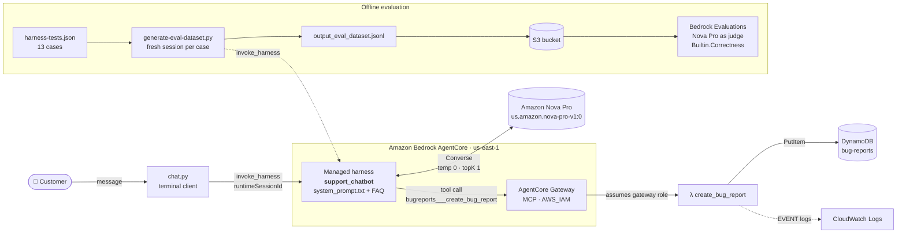
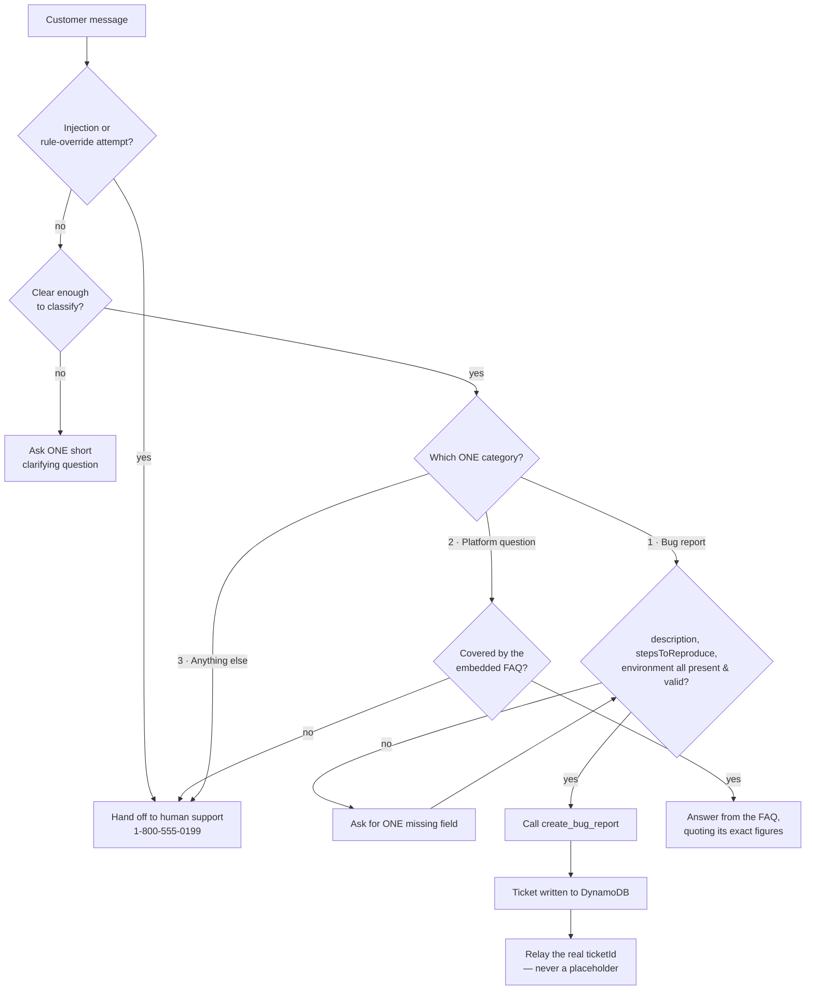

<div align="center">

# 🛟 Support Chatbot on Amazon Bedrock AgentCore

**A customer-support agent whose entire routing logic lives in one system prompt —<br>built, evaluated and stress-tested against the database it writes to.**

[](https://docs.aws.amazon.com/bedrock-agentcore/latest/devguide/harness.html)
[](https://aws.amazon.com/ai/generative-ai/nova/)
[](https://www.python.org/)
[](#-quickstart)
[](#-evaluation-results)
[](#-credits--license)

</div>

---

## ✨ TL;DR

| | |
|---|---|
| **What** | A support chatbot for a fictional online shop that handles three kinds of messages: **bug reports** (multi-turn collection → ticket in DynamoDB), **platform questions** (answered strictly from an FAQ), and **everything else** (polite hand-off to a human line). |
| **How** | Amazon Bedrock **AgentCore managed harness** + **AgentCore Gateway** (MCP) exposing a Lambda tool. No classifier, no condition nodes — **routing is 100 % prompt engineering**. |
| **Proof** | 13-case test suite scored by **Bedrock Evaluations (LLM-as-a-judge)**: **0.92 correctness on two independent runs**, 0 mis-routed messages, 2/2 prompt-injection attempts refused. |
| **The interesting part** | The score hid the most serious defect. Cross-checking chat transcripts against **DynamoDB rows** revealed **fabricated ticket IDs** and **junk fields** that a correctness metric can't see. → [Findings](#-what-the-score-didnt-show) |

> **Context.** Built in 2026 for the **Udacity × AWS Future Agent Engineer Nanodegree**. Bedrock *Agents Classic* closed to new customers on 30 July 2026, so the project runs on its successor, the AgentCore managed harness.

---

## 🏗️ Architecture

### System view



All infrastructure is code: `cloudformation-tool.yaml` (DynamoDB + Lambda + 3 IAM roles) and `cloudformation-testing.yaml` (S3 + evaluation role). The AgentCore resources are created by `setup_gateway.py` and `create_harness.py`, which read the stack outputs themselves.

### Routing logic (implemented entirely in the prompt)



Every branch above maps to a named rule in [`system_prompt.txt`](project/starter/system_prompt.txt) — including **15 explicit tie-breakers** for ambiguous messages (a declined card is a payments question, not a bug; a cracked mug is a returns question; a search returning nothing *is* a bug…). The full rule-to-branch table is in [`SUBMISSION.md`](project/starter/SUBMISSION.md#routing-conditions).

---

## 📸 Screenshots

<table>
<tr>
<td width="50%">

**A complete report filed in one turn** — the tool call fires and a real UUID comes back.


</td>
<td width="50%">

**Edge cases** — vague message, ambiguous "card declined", two injection attempts.


</td>
</tr>
<tr>
<td width="50%">

**FAQ extension picked up live** — new entries 33–35 answered after a single `create_harness.py` re-run.


</td>
<td width="50%">

**Ground truth** — the DynamoDB scan used to audit what the bot *claimed* to file.


</td>
</tr>
<tr>
<td width="50%">

**Bedrock Evaluations** — 12/13 prompts at 1.0, average 0.923.


</td>
<td width="50%">

**AgentCore harness** — `support_chatbot`, READY.


</td>
</tr>
</table>

<details>
<summary><b>More evidence (gateway, Lambda test, eval jobs, per-prompt details, all tickets)</b></summary>

| Step | Screenshot |
|---|---|
| Gateway created | [`setup_gateway_chatbot_mialy_OK.png`](project/starter/Screenshots%20AWS/setup_gateway_chatbot_mialy_OK.png) · [`AgentCore_gateway_creation.png`](project/starter/Screenshots%20AWS/AgentCore_gateway_creation.png) |
| Lambda tested in isolation | [`lambda_test_OK.png`](project/starter/Screenshots%20AWS/lambda_test_OK.png) |
| Harness created / memory disabled | [`create_harness.py_READY.png`](project/starter/Screenshots%20AWS/create_harness.py_READY.png) · [`harness_disabled_memory_command_OK.png`](project/starter/Screenshots%20AWS/harness_disabled_memory_command_OK.png) |
| Multi-turn collection | [`multitour_ticketID_proof_1_OK.png`](project/starter/Screenshots%20AWS/multitour_ticketID_proof_1_OK.png) → [`_4_OK.png`](project/starter/Screenshots%20AWS/multitour_ticketID_proof_4_OK.png) |
| Dataset generation | [`harness_generating_dataset_1_OK.png`](project/starter/Screenshots%20AWS/harness_generating_dataset_1_OK.png) |
| Testing stack + S3 upload | [`testing_stack_OK.png`](project/starter/Screenshots%20AWS/testing_stack_OK.png) · [`AWS_S3_bucket_upload_OK.png`](project/starter/Screenshots%20AWS/AWS_S3_bucket_upload_OK.png) |
| Eval jobs (run 1 & 2) | [`eval_job_run1_run2_OK.png`](project/starter/Screenshots%20AWS/eval_job_run1_run2_OK.png) · [`eval_score_run2_0.92_OK.png`](project/starter/Screenshots%20AWS/eval_score_run2_0.92_OK.png) |
| Per-prompt judge details | [`eval_run_prompt_details_1.png`](project/starter/Screenshots%20AWS/eval_run_prompt_details_1.png) · [`prompt_details_run2_1_OK.png`](project/starter/Screenshots%20AWS/prompt_details_run2_1_OK.png) |

All screenshots: [`project/starter/Screenshots AWS/`](project/starter/Screenshots%20AWS/)

</details>

---

## 📊 Evaluation results

Test suite: [`harness-tests.json`](project/starter/harness-tests.json) — 13 single-turn prompts, each run in a **fresh session** (harness memory disabled so cases can't contaminate each other).

| Route | Cases | Examples |
|---|:---:|---|
| Bug report | 3 | complete report · missing environment · missing steps |
| Platform question (FAQ) | 3 | return window · refund timing · customs (added FAQ entry) |
| Hand-off | 2 | student discount · "I want a real person" |
| Edge cases | 5 | `help` · card declined · damaged item · 2 prompt injections |

| Run | Dataset | Judge | Correctness |
|---|---|---|:---:|
| `support-chatbot-eval-run-1` | `output_eval_dataset_run1.jsonl` | Nova Pro | **0.92** |
| `support-chatbot-eval-run-2` | regenerated after prompt fixes | Nova Pro | **0.92** |

12/13 prompts scored 1.00 in both runs. No message was routed to the wrong behaviour. The one failure (`t3_bug_report_missing_steps`) failed identically twice — a reproducible defect, not judge noise. Explained below.

---

## 🔍 What the score didn't show

The most valuable part of this project wasn't the 0.92 — it was finding what a single-turn correctness metric is blind to. Full write-up: [`OBSERVATIONS.md`](project/starter/OBSERVATIONS.md).

1. **Fabricated ticket IDs.** In a multi-turn conversation the bot confidently replied *"filed with ticket ID #12345"* — but there was no `[tool call]` line and the table still held 9 rows, not 10. Across attempts it produced `#12345`, `TICKET1234`, `TIX-345678`: placeholder-shaped strings, never a UUID. A customer would have left believing their bug was logged. → Fix: an explicit rule that the only ID ever given is the exact `ticketId` returned by a successful call.
2. **Junk written into the database.** `t3` ("The app keeps logging me out. Chrome on Windows 11.") returned a real ticket — so the chat looked fine — but `stepsToReproduce` held either *the bot's own clarifying question* or the filler `"Using the app."`. Root cause: a deliberately lenient steps rule that breaks when fault and trigger are the same sentence.
3. **Exploratory tool calls.** The model called `create_bug_report` with a missing field just to let the Lambda's validation tell it what was missing. → Fix: "a failed tool call is never a way to discover a missing field".
4. **Reasoning leaks.** Nova Pro prefixed answers with `<thinking>…</thinking>`. Moving the rule to the very top of the prompt reduced it from most responses to occasional — not to zero.

**Takeaway:** for tool-using agents, assert on the **side effects** (the stored row), not only on the conversational text. Both real defects were found by comparing a transcript with the DynamoDB row it claimed to have created.

### Known limitations

- Multi-turn ticket filing remains unreliable with Nova Pro (premature call without retry, or skipped call).
- Long-prompt adherence is uneven across sessions even with greedy decoding (temperature 0, topK 1).
- Next step: shorten and restructure the prompt, and add a test harness that asserts on DynamoDB rows.

---

## 🚀 Quickstart

> **Prerequisites:** AWS account with Bedrock + AgentCore access, AWS CLI configured, Python 3.9+, access to `us.amazon.nova-pro-v1:0`. Everything runs in **us-east-1**.

```bash
cd project/starter
python -m venv venv && source venv/bin/activate
pip install -r requirements.txt

# 1 · Tool stack: DynamoDB + Lambda + IAM roles
aws cloudformation deploy --template-file cloudformation-tool.yaml \
  --stack-name bug-report-tool-stack --capabilities CAPABILITY_NAMED_IAM --region us-east-1

# 2 · Gateway + Lambda target  → writes agentcore_config.json
python setup_gateway.py

# 3 · Harness from system_prompt.txt (+ FAQ injected at {{FAQ}})
python create_harness.py      # re-run after every prompt change

# 4 · Talk to it
python chat.py                # one run = one session

# 5 · Evaluate
python generate-eval-dataset.py --tests-json harness-tests.json
aws cloudformation deploy --template-file cloudformation-testing.yaml \
  --stack-name bug-report-testing-stack --capabilities CAPABILITY_NAMED_IAM --region us-east-1
# upload output_eval_dataset.jsonl to the bucket, then create a Bedrock Evaluations job
```

**Verify tickets really landed:**

```bash
aws dynamodb scan --table-name bug-report-tool-stack-bug-reports --region us-east-1 \
  --query 'Items[].[ticketId.S,description.S,stepsToReproduce.S,environment.S]'
```

### 🧹 Cleanup (avoid charges)

```bash
python cleanup_agentcore.py
aws cloudformation delete-stack --stack-name bug-report-tool-stack --region us-east-1
aws s3 rm s3://udacity-agentic-engineer-c1-eval-<ACCOUNT_ID> --recursive   # empty the bucket first
aws cloudformation delete-stack --stack-name bug-report-testing-stack --region us-east-1
```

Full step-by-step instructions: [`project/README.md`](project/README.md).

---

## 🗂️ Repository structure

```text
project/starter/
├── system_prompt.txt            ⭐ the deliverable — all routing & behaviour rules
├── online_shop_faq.md           FAQ embedded at {{FAQ}} (entries 33–35 added)
├── harness-tests.json           13-case evaluation suite
│
├── cloudformation-tool.yaml     DynamoDB + Lambda + gateway/harness IAM roles
├── cloudformation-testing.yaml  S3 bucket + Bedrock Evaluations role
├── create_bug_report.py         Lambda tool (validates all 3 fields, writes the ticket)
├── setup_gateway.py             AgentCore Gateway (MCP, IAM auth) + Lambda target
├── create_harness.py            create/update harness — Nova Pro pinned, greedy decoding, memory off
├── chat.py                      streaming terminal client, shows [tool call] lines
├── generate-eval-dataset.py     runs the suite → Bedrock Evaluations JSONL
├── cleanup_agentcore.py         deletes harness, target, gateway
│
├── SUBMISSION.md                architecture, routing table, disclosed script changes
├── OBSERVATIONS.md              evaluation analysis & findings
├── *-transcript.txt             recorded chat sessions
├── dynamodb-tickets.txt         table scan used for auditing
└── Screenshots AWS/             console & terminal evidence
```

---

## 🧠 Engineering notes worth knowing

- **Gateway target names:** letters, digits and underscores only. A dash breaks Nova tool calling with *"Model produced invalid sequence as part of ToolUse"*.
- **Tool naming:** the model sees `<targetName>___<toolName>` (three underscores) → `bugreports___create_bug_report`.
- **Event shape:** the Gateway passes tool arguments **directly** as the Lambda event (no Agents Classic `parameters` envelope); the tool name arrives in `context.client_context.custom["bedrockAgentCoreToolName"]`.
- **Disabling memory:** `create_harness` takes `memory={"disabled": {}}` but `update_harness` needs `memory={"optionalValue": {"disabled": {}}}` — passing the create shape to update fails.
- **Pin the model** on the harness *and* on every invoke; the harness default requires a Marketplace subscription lab accounts can't complete.
- **Session IDs** must be ≥ 33 characters (UUID + suffix).

---

## 🛠️ Built with

Amazon Bedrock AgentCore (managed harness · Gateway) · Amazon Nova Pro · Amazon Bedrock Evaluations · AWS Lambda · Amazon DynamoDB · Amazon S3 · AWS CloudFormation · IAM · CloudWatch Logs · Python / boto3

---

## 🙏 Credits & license

Starter code, CloudFormation templates and project brief by **[Udacity](https://www.udacity.com/)** for the *Prompting for Effective LLM Reasoning* course of the **AWS Agent Engineer Nanodegree**. System prompt, test suite, FAQ extension, evaluation runs, defect analysis and documentation by **Mialy Ratsimbazafy** ([@ellebuild](https://github.com/Mialy333)).

Educational content is subject to Udacity's terms — see [`LICENSE.md`](LICENSE.md).
